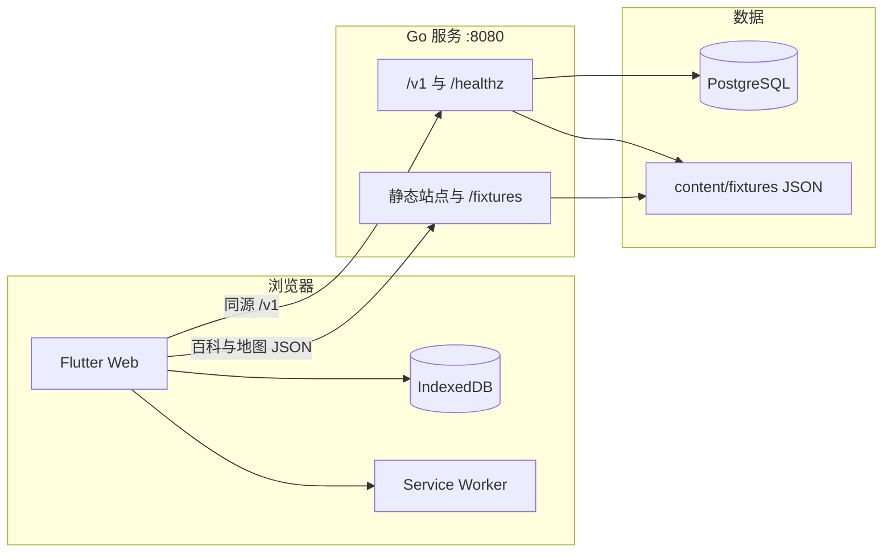

# MH伙伴助手开发文档

本文描述当前仓库里已经落地的实现，方便后续改代码和验收。规格原文在 [GROK_BUILD_SPEC.md](GROK_BUILD_SPEC.md)。界面以 [execution/ui-style.md](execution/ui-style.md) 记录的落地为准，那份说明整理自设计规范，没有改设计原文。

**发布状态：尚未发布。** 没有公网 HTTPS 地址。需要所有者在 Cursor 发布托盘点击 **Publish**，并在 Apps dashboard 的 **Access** 中设为 **Public**。见下文「部署与发布」。

### 目录

1. [技术栈与架构](#stack)
2. [目录结构](#layout)
3. [数据模型与数据库](#data-model)
4. [API 列表与鉴权](#api)
5. [离线与同步](#offline-sync)
6. [本地环境与 make 命令（dev/verify/build/audit-data）](#make-commands)
7. [测试策略](#testing)
8. [CI](#ci)
9. [部署与发布](#deploy)
10. [数据导入](#import)
11. [已知问题](#known-issues)

<a id="stack"></a>

## 技术栈与架构

| 层 | 技术 |
| --- | --- |
| 浏览器 | Flutter Web（`material_ui`、`go_router`），字体为随包的 Noto Sans SC / TC / JP / Noto Sans |
| 个人与资料缓存 | IndexedDB（`idb_shim`），站点外壳用 `apps/web/web/sw.js` |
| 配装计算 | 纯 Dart 求解器，页面用 `compute` 放到隔离线程 |
| 同源 API 与静态资源 | Go 1.22，`net/http`，模块 `services/api` |
| 账户数据 | PostgreSQL。本仓库迁移见 `services/api/migrations/001_player_records.sql` |
| 契约 | `contracts/openapi.yaml` 与 `contracts/schemas/` |

访客打开公开页不需要登录。公开配装只读已发布快照。私稿在浏览器个人库里，同步之后只出现在该账户的 snapshot / pull，公开接口读不到。



作品切换不换主题。默认浅色羊皮纸（`data-theme=light`），可选深色冰原（`data-theme=dark`）。世界和荒野用当前主题里的圆点区分。

<a id="layout"></a>

## 目录结构

| 路径 | 作用 |
| --- | --- |
| `apps/web/` | Flutter Web。页面在 `lib/pages.dart`，壳和主题在 `lib/shell.dart`、`lib/theme.dart` |
| `packages/catalog/` | 百科搜索、地图点、资料包验签与安装 |
| `packages/builds/` | 配装求解和荒野 JSON 导入预览 |
| `packages/player_store/` | 访客分区、收藏、库存、配装和 outbox |
| `services/api/` | Go 服务、迁移、API 测试 |
| `content/fixtures/` | 合成夹具、签名清单、活动与公开配装种子 |
| `contracts/` | OpenAPI、JSON Schema、导入样例 |
| `tools/` | `doctor`、`dev.sh`、夹具生成、公开资料矩阵 |
| `tests/acceptance/` | Playwright 浏览器流程 |
| `docs/execution/` | 功能对照、风格落地、浏览器截图、任务状态 |
| `.github/workflows/ci.yml` | 推送和 PR 上的 Go 测试 |

主要路由：

| 路径 | 页面 |
| --- | --- |
| `/` | 首页。作品切换、活动、资料、世界地图入口 |
| `/g/:gameId/entries` | 百科列表 |
| `/g/:gameId/entries/:kind/:entryId` | 百科正文 |
| `/g/:gameId/maps/:mapId` | 世界地图。荒野没有地图页 |
| `/g/:gameId/builds` | 配装 |
| `/g/:gameId/events/:id` | 活动 |
| `/builds/:publicId` | 已发布配装。撤回或不存在不展示装备 |
| `/me` | 收藏、配装计数、语言、外观、登录 |
| `/offline` | 按作品下载夹具包 |

<a id="data-model"></a>

## 数据模型与数据库

百科条目的稳定引用是 `(gameId, kind, entryId)`。`gameId` 只有 `world` 和 `wilds`。冰原是 `world` 的内容档 `iceborne`，不是第三个 `gameId`。当前数据包版本号是 `fixture-1`，标记 `fixture: true`，不是游戏实数。

浏览器侧：

- 资料包正文写入 IndexedDB 键 `pack-{gameId}`，激活版本记在安装器的 `activeRevision`。
- 收藏、语言、主题、离线标记写在 IndexedDB 的 `meta`。
- 未同步的配装对象在内存里的 `PlayerStore`。刷新页面会丢掉尚未同步的内存配装。

PostgreSQL 表（启动时执行 `001_player_records.sql`）：

| 表 | 内容 |
| --- | --- |
| `accounts` | 用户 id 与显示名 |
| `sessions` | 会话 token 的 SHA-256，过期与撤销 |
| `entitlements` | `plan_id`、`quota_bytes`、`used_bytes` |
| `account_state` | 同步游标 `next_cursor` 与过期下界 `min_cursor` |
| `player_records` | 收藏、库存、配装。主键 `(owner_id, game_id, record_type, record_id)` |
| `sync_log` / `sync_ops` | 按游标的变更日志，以及 `opId` 幂等结果 |
| `public_builds` | 已发布快照。`retracted_at` 非空表示撤回 |
| `events` / `articles` | 夹具日程和短文 |
| `reminder_subs` / `reminder_jobs` | 提醒订阅和待发任务 |

收藏的唯一约束是 `(owner_id, game_id, kind, entry_id)`，避免两作同号条目撞在一起。私稿行不在 `public_builds` 里。

开发环境额度：`hunter-b` 是小档 800 字节，其他开发用户是 20000 字节。这是测试档，不是售价。

<a id="api"></a>

## API 列表与鉴权

统一错误体：`{code, messageKey, requestId, details}`。写请求如果带了 `Origin`，主机必须和请求主机一致，否则 403 `CSRF`。

会话 cookie 名 `mh_session`，HttpOnly、SameSite=Lax。仅在 TLS 或 `X-Forwarded-Proto: https` 时加 `Secure`。服务端只存 token 哈希。登录接口只在环境变量 `MH_DEV_AUTH=1` 时存在，请求体为 `{"provider":"dev","userId":"..."}`。`make dev` 会打开这个开关。生产进程不要设置它。

| 方法与路径 | 谁可以调用 | 行为 |
| --- | --- | --- |
| `GET /healthz` | 匿名 | 数据库可 ping 时 `{"status":"ok"}` |
| `GET /v1/packs/latest` | 匿名 | 按 `gameId` 返回签名清单。客户端过低为 422。`ETag` 命中为 304 |
| `GET /v1/events` | 匿名 | `gameId`、`q`、`reward` 筛选 |
| `GET /v1/events/{id}` | 匿名 | 活动详情，含核实时间 |
| `GET /v1/events/{id}/calendar.ics` | 匿名 | 日历文件，UID 稳定 |
| `GET /v1/articles` | 匿名 | 短文列表 |
| `GET /v1/public-builds` | 匿名 | 未撤回的大厅。可按 `gameId`、`weaponType`、`rarity` |
| `GET /v1/public-builds/{id}` | 匿名 | 已发布快照。撤回为 410 `RETRACTED` 且不带 snapshot。没有记录为 404 |
| `POST /v1/public-builds` | 登录 | 只保存调用者提交的公开字段 |
| `DELETE /v1/public-builds/{id}` | 作者 | 撤回。别人是 403 |
| `POST /v1/auth/session` | 开发开关 | 建立会话 |
| `POST /v1/auth/refresh` | 登录 | 轮换会话 |
| `DELETE /v1/auth/session` | 持有 cookie | 撤销会话 |
| `GET /v1/me/entitlement` | 登录 | 额度。未登录 401 |
| `POST /v1/sync/push` | 登录 | 逐条 `applied`、`conflict` 或 `rejected`。相同 `opId` 和内容返回原结果，内容不同则 `IDEMPOTENCY_CONFLICT` |
| `GET /v1/sync/pull` | 登录 | `cursor` 过期为 409 `CURSOR_EXPIRED` |
| `GET /v1/sync/snapshot` | 登录 | 该账户未删除记录和水位 |
| `POST /v1/reminders/subscriptions` | 匿名须带 `revokeToken`，登录则绑账户 | 订阅提醒 |
| `DELETE /v1/reminders/subscriptions/{id}` | 持有撤销凭证或对应账户 | 取消 |
| `POST /v1/dev/events/{id}` | 仅 `MH_DEV_AUTH=1` | 改期或撤销夹具活动 |
| `POST /v1/dev/entitlement` | 同上且已登录 | 改自己的测试额度 |
| `POST /v1/dev/compact` | 同上 | 把游标下界推到当前，用于过期测试 |
| `GET /v1/dev/reminder-jobs` | 同上 | 查看待发提醒 |

个人数据响应带 `Cache-Control: private, no-store`。Service Worker 不缓存 `/v1/`。

<a id="offline-sync"></a>

## 离线与同步

首次打开需要网络，以便拿到页面和夹具 JSON。`/offline` 或首页「查看更新」会请求 `/v1/packs/latest`，下载清单里的 URL，用内置公钥验 Ed25519 签名并核对 SHA-256。签名或哈希不对、配额不够、或修订号比已激活的更旧时，不切换激活版本。

世界和荒野分开下载。删除入口目前只覆盖该次安装结果，不删另一作。账号数据和公共资料包不是同一个 IndexedDB 对象库。

同步路径：界面把配装写入 `PlayerStore` 和 outbox，登录后 `POST /v1/sync/push`。服务端按账户加行锁算额度，超额返回 `QUOTA_EXCEEDED`，基线修订不符返回 `REVISION_CONFLICT` 且不覆盖。其他设备用 snapshot 或 pull 读取自己的行。公开 `GET` 不会返回这些行。

<a id="make-commands"></a>

## 本地环境与 make 命令（dev/verify/build/audit-data）

需要 Python 3、Go 1.22、Flutter stable（含 Dart）、Chrome，以及本机可连的 PostgreSQL。默认连接串：

```text
postgres://ubuntu@127.0.0.1:5432/mhbuddy?sslmode=disable
```

库不存在时进程会连到 `postgres` 库并创建 `mhbuddy`。测试库是 `mhbuddy_test`。请先让 Postgres 在 5432 上接受本机 trust 连接。Flutter 和 `pg_ctl` 若装在 `$HOME/flutter`、`$HOME/pg`，`Makefile` 会把它们加进 `PATH`。

| 命令 | 作用 |
| --- | --- |
| `make doctor` | 检查 python3、go、flutter、dart、node、chrome、postgres。缺 python3 或 go 时非零退出 |
| `make research-mh` | 重写夹具 JSON、签名清单，以及 `docs/execution/` 里的功能对照 |
| `make dev` | 后台启动夹具预览和 API，默认 `0.0.0.0:8080`。可用 `PORT` 覆盖。健康检查通过后打印 `http://127.0.0.1:8080/` |
| `make dev-stop` | 停本次 `make dev` 的进程，不停 Postgres |
| `make verify` | `doctor`、`research-mh`、Go 测试、catalog / builds / player_store 的 `dart test`、Flutter 文案测试 |
| `make build` | `flutter build web --release --pwa-strategy=none`，再把 Go 服务编到 `.run/mhbuddy` |
| `make audit-data` | 没有正式资料清单时打印原因并退出码 1。这是预期，不是夹具验签失败 |
| `make check TASK=T04` | 跑指定任务的检查。`T11` 会说明发布要所有者操作并退出码 2 |

`make dev` 设置 `MH_DEV_AUTH=1`。最近一次在本仓库执行：`make dev` 退出码 0，`/healthz` 为 200；`make build` 退出码 0。

<a id="testing"></a>

## 测试策略

| 范围 | 位置 | 覆盖 |
| --- | --- | --- |
| 契约 | `services/api/internal/contract` | 两份荒野配装样例符合 schema，OpenAPI 含主要路径 |
| API | `services/api/internal/api` | 匿名同步 401、幂等、修订冲突、额度、收藏按作品分开、活动名和报酬检索、撤回后 410、清单 304 |
| 百科与安装 | `packages/catalog` | 别名、大小写、全角、冰原筛选、同名异作、地图分层、坏签名和坏哈希 |
| 求解与导入 | `packages/builds` | 两孔两珠才有解、预留武器孔、样例往返、错孔 |
| 个人库 | `packages/player_store` | 事务回滚、分区、冲突副本 |
| 文案 | `apps/web/test` | 简中、繁中、英语、日语键一致 |
| 浏览器 | `tests/acceptance` | 先 `make dev`，再 `npm install && npm test`。桌面 1440×900 与手机 390×844 |

浏览器验收使用系统 Chrome，不下载另一套浏览器。私稿检查使用互不共享 cookie 的新会话：所有者能看到自己的配装和 snapshot；访客打开私稿 id 得到「没有这条公开记录」，公开接口 404，匿名 snapshot 401；另一账户的 snapshot 不含该记录。

<a id="ci"></a>

## CI

`.github/workflows/ci.yml` 在 push 和 pull request 时运行。作业名是 `go`：Ubuntu 上启动 Postgres 16，用户 `ubuntu`、本机 trust，然后在 `services/api` 执行 `go test ./...`。它不跑 Flutter、浏览器或 `make verify`。

分支 `cursor/mh-companion-web-8598` 上最近一次该检查结论为 success。

<a id="deploy"></a>

## 部署与发布

生产进程应：

1. 使用持久 PostgreSQL，执行同一份迁移。
2. 不要设置 `MH_DEV_AUTH`。
3. 用 `make build` 的 `apps/web/build/web` 作为 `WEB_ROOT`，`content/fixtures` 作为 `CONTENT_DIR`。
4. 监听宿主端口，对外只暴露 HTTPS。

**当前没有完成发布，也没有公网地址。** 所有者需要：

1. 打开这次 Cloud Agent 的应用预览。
2. 在发布托盘选择 **Publish**，并确认站点地址。
3. 在 Apps dashboard 的 **Access** 中把可见性设为 **Public**。

说明见 [Cursor Apps 文档](https://cursor.com/docs/cloud-agent/apps)。若团队关闭了公开分享，要管理员先打开该项。代理不能代替点击，也不应填写一个还不存在的 URL。

<a id="import"></a>

## 数据导入

夹具不是实数。生成和签名：

```bash
python3 tools/content/build_fixtures.py
cd services/api && go run ./cmd/mhbuddy pack
```

`make research-mh` 会把这两步连起来，并写出移动端对照 [execution/mh-mobile-parity.md](execution/mh-mobile-parity.md) 和游民对照 [execution/gamersky-parity.md](execution/gamersky-parity.md)。对照只采用已核实的公开页事实，待复核项保持待复核。

服务启动时把 `content/fixtures/events.json`、`articles.json`、`public-builds.json` 插入数据库，已有主键不会覆盖。百科和地图不进 Postgres，由 `/fixtures/catalog-world.json` 和 `catalog-wilds.json` 直接给浏览器。

荒野配装文件格式是 `mhbuddy.build`，样例在 `contracts/examples/wilds-build-v1.fixture.json` 和 `wilds-build-equipped.fixture.json`。配装页可以粘贴 JSON 预览。错孔、跨作和未知 id 不会写入已有记录。第三方旧格式还没有适配器。

正式资料应走单独清单和 `make audit-data`。在提供发行清单、对照表和种子之前，该命令会失败。

<a id="known-issues"></a>

## 已知问题

- 数据包是合成夹具。准确度审计没有正式输入，不能声称达到 98% 或 99%。
- 尚未发布，没有公网 HTTPS 地址。
- 设计规范第 11 节仍待复核，见 [execution/ui-style.md](execution/ui-style.md)。资讯双列、MR 圆标、深色 New 缎带还没有按示意画全。
- 荒野公开简介没有地图，因此没有荒野地图页。
- 机械武器、猫饭、极限突破只记在功能矩阵，没有做成模拟器。
- 会员没有真实支付。额度只在开发开关下可改。
- 浏览器里未同步的配装在整页刷新后会消失。收藏和主题会留在 IndexedDB。
- CI 只跑 Go 测试。Flutter 和浏览器要在本地 `make verify` 与 `tests/acceptance` 里跑。
- `make dev` 依赖本机 Postgres 已经在听 5432。仓库不附带安装脚本。
